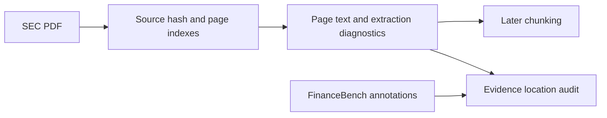

# Module 2: PDF extraction and source locations

**Status:** approved for implementation by the user's “implement it” instruction.
Branch: `feat/pdf-ingestion`, based on merged
Module 1 at `18b035f74c37fad7a670f87b9f5549652b2c8c11`.

## Goal and approach

Turn a text-based PDF from any company into page-addressable text for later chunking.
Use the two cached AMD filings to inspect extraction quality and validate FinanceBench
evidence locations. Keep gold annotations outside the generic extraction interface.

Recommended baseline: [pypdf](https://pypdf.readthedocs.io/en/stable/user/extract-text.html),
using plain extraction by default and layout extraction for comparison. Its
[license](https://github.com/py-pdf/pypdf/blob/main/LICENSE) is BSD-3-Clause. Add it as the
only new runtime dependency after design and implementation-plan approval.

Alternative: [pdfplumber](https://github.com/jsvine/pdfplumber) provides table extraction
and detailed positional information. Introduce that when investigating structured table
recovery; this module first makes the limitations of text extraction visible.

## Interfaces and behavior

- Generic package: `finsight.ingestion`.
- `extract_pdf(path: Path, *, mode: Literal["plain", "layout"] = "plain") -> ParsedDocument`.
- `ParsedDocument` records source filename, SHA-256, parser name/version, extraction mode,
  total page count, document diagnostics, and ordered `ParsedPage` records.
- Each page preserves its zero-based physical index, extracted text, and status
  (`text`, `no_text`, or `error`) with diagnostics. Keep every page, including empty pages,
  so citation positions remain stable. Display page position is index + 1.
- Preserve extracted content; do not rewrite financial values, strip headers, or merge
  pages in this baseline. Layout mode is a comparison, not a structured-table guarantee.
- Missing, unreadable, malformed, or encrypted documents raise a clear extraction error.
  Per-page extraction failures retain the page index and an error diagnostic. A page
  without extracted text is flagged for inspection; that alone does not prove it is scanned.
- A small extraction command can write parsed JSON to an explicit output path; documented
  examples use the ignored `.artifacts/pdf-ingestion` directory.
- A separate FinanceBench adapter exposes
  `audit_evidence_locations(dataset, parsed_by_doc) -> EvidenceLocationReport` and an
  `audit-evidence` command. It checks source identity, document resolution, page bounds,
  and whether referenced pages contain extracted text. It accounts for all annotations,
  including repeated references to the same page.
- The notebook juxtaposes annotated support with parsed page text for inspection.
  These diagnostics are not retrieval, answer-correctness, or grounding metrics.

## Learning notebook

Create `notebooks/02_pdf_ingestion.ipynb` with short descriptions: one or two sentences
per section, roughly 150–250 explanatory words overall. Explain only four major concepts:
page provenance, extraction versus layout, pages without text, and evidence alignment.
Include the Mermaid flow above and one experiment comparing plain/layout output on a
financial statement page. Use package functions and bounded text previews.

Extend the existing notebook verifier with an optional notebook selection while preserving
Module 1 defaults. Execute Module 2 offline on synthetic PDFs and the real warm AMD cache.
Keep source notebook outputs empty and generated text/reports outside Git. Preserve the
user's locally executed Module 1 notebook without adding it to Module 2 commits.

## Acceptance and boundary

- TDD with valid authored PDFs covers page order/indexes, empty and mixed-text pages,
  financial numbers, plain/layout modes, malformed/encrypted input, page failures,
  source hashes, and missing/out-of-range evidence references.
- Parse both real AMD PDFs; report actual page counts, no-text/error pages, and extraction
  duration. Account for all nine evidence annotations and report their bounds checks.
- Inspect extraction on narrative and financial-statement pages. Report observed losses
  or ordering problems without claiming that text presence establishes correct extraction.
- Existing tests, new tests, Ruff, notebook execution, and package build must pass.
- No OCR, structured table reconstruction, chunking, embeddings, model calls, or UI work
  in this module. Review the implementation before starting the next module.

Implementation follows approval of this design and its implementation plan, preserving
the module review workflow requested in the original project brief.
